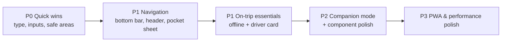

# Thailand 2027 — Mobile UI/UX Improvement Plan

**Target Route:** `/naanas-space/thailand-2027-v2` (preserving `/naanas-space/thailand-2027` v1 desktop layout untouched; both routes share the same live data & state) · **Audience:** Shaq & Naana · **Main use case:** phones, both before the trip (planning) and in Thailand (4–14 Feb 2027)  
**Device Priority:** Android-first (**Google Pixel** / Chrome on Android primary); iOS Safari compatibility is nice-to-have.  
**Companion Docs:** [`thailand_2027_mobile_ux_open_decisions.md`](./thailand_2027_mobile_ux_open_decisions.md) · [`thailand_2027_mobile_ux_v2_drawbacks.md`](./thailand_2027_mobile_ux_v2_drawbacks.md) · [`thailand_2027_mobile_ux_plan.html`](./thailand_2027_mobile_ux_plan.html)

> [!NOTE]
> This plan comes from reading the current code (`page.tsx`, `StickyStepNav`, `TopEditorialBar`, `EditorialMasthead`, `QuickPocketDesk`, the drawers and modals, and the six Step components). Every change has to keep the copywriting rules in `thailand_2027_context_handoff.md`: always "Shaq", never "Shaquille", and no second-person copy aimed at Shaq alone.  
> **Route & Shared-Data Architecture (Option 1 — `/naanas-space/thailand-2027-v2`):** The live `/naanas-space/thailand-2027` (`src/app/naanas-space/thailand-2027/`) page remains **untouched** to preserve the current desktop layout as `v1`. All Phases 1–5 UI changes are implemented in a new **`src/app/naanas-space/thailand-2027-v2/`** route that imports the exact same static data (`@/lib/thailandTripData`), `localStorage` keys (`STORAGE_KEY = "naanas_space_thailand_2027_v1"`, `ACTOR_STORAGE_KEY = "naanas_space_thailand_2027_actor"` in `types.ts`), state hook (`useThailandTripState.ts`), and Upstash Redis API (`/api/naanas-space/thailand-2027`, `REDIS_KEY = "naanas_space_thailand_2027_v1"`). Edits made on `v2` immediately appear on `v1` and vice versa. (See [`thailand_2027_mobile_ux_v2_drawbacks.md`](./thailand_2027_mobile_ux_v2_drawbacks.md) for dual-route trade-offs, backwards-compatible schema rules, and cross-tab sync mitigations.)  
> **Target Environment:** **Google Pixel (Chrome on Android, Gboard, Android gesture navigation, WebAPK PWA install)** is the primary target environment; iOS Safari edge cases (`16px` input zoom prevention, safe-area insets, manual Add to Home Screen fallback) are retained as secondary nice-to-have compatibility.

---

## 1. What we found (mobile audit)

| # | Area | Current behaviour | Mobile impact |
|---|------|-------------------|---------------|
| A1 | **Sticky step nav** (`StickyStepNav.tsx`) | `grid-cols-2` on mobile, so 6 tabs = **3 stacked rows**, plus the date ruler on Step I | Even when compact, the sticky header takes about 25–35% of a 412×915 Pixel or 390×844 screen, leaving little room for content |
| A2 | **Floating elements collide** | Quick Pocket Desk `fixed bottom-5 left-5`, scroll-to-top `fixed bottom-5 right-5`, and "Copied" toast `fixed bottom-6 right-6` | The toast sits on top of the scroll button. The open Pocket Desk (`w-80`, 320px plus a 20px inset) runs off the edge of 320–360px phones. Nothing accounts for Android gesture navigation bars or the iPhone home indicator |
| A3 | **Tap targets** | Activity checkboxes are `w-5 h-5` (20px). Top-bar buttons use `py-0.5`. Compact day-ruler chips use `py-0.5` | Well under the 44×44px minimum, so mis-taps are likely, especially while walking around |
| A4 | **Tiny type** | ~143 × `text-[10px]`, 26 × `text-[9px]`, 3 × `text-[8px]`, often uppercase with wide tracking | Hard to read on a phone in bright sunlight |
| A5 | **Mobile keyboards & input zoom** | All 36 inputs use `text-xs`/`text-sm` (<16px). Currency uses `type="number"`. Times are free-text | Gboard/Android and iOS need optimised numeric/decimal keyboards without breaking decimals (`£22.47`) or string times (`19:00 ICT` / `Flexible`), and iOS Safari zooms in on focus below `16px` |
| A6 | **Hover-only affordances** | Polaroid "Expand ⤢" pill is `opacity-0 group-hover:opacity-100`. 17 `title=""` tooltips carry helpful explanations | Touch devices never show any of these |
| A7 | **Drawers & modals** | Change Log and Wardrobe drawers are right-side slide-overs with `p-6`. `CreateLookModal` uses `max-h-[90vh]`. There's no body scroll lock and no swipe to dismiss | `vh` misbehaves when Android Chrome / iOS URL bars or Gboard open and close. Thumbs can't reach the close buttons (top-right), and edge-swipes fight Pixel system Back gestures. The page behind can scroll |
| A8 | **Top editorial bar** | Back link, editor toggle, change log, sync status and dates all `flex-wrap` | Wraps onto 2–3 rows on phones and looks cluttered before any content shows |
| A9 | **Masthead** | `text-5xl` title plus a `text-4xl` countdown and the readiness dossier | The first screen on a phone is all branding, with no actionable content |
| A10 | **Budget ledger** | `<table>` inside `overflow-x-auto` | Needs sideways scrolling on phones, and the columns are cramped |
| A11 | **Itinerary rows** | Each activity can show checkbox, EDIT, REMOVE, outfit/hanger, INFO and links inline | Action-heavy rows wrap untidily and are easy to mis-tap |
| A12 | **Offline / connectivity** | State goes to localStorage and then a cloud sync. Fonts load through `@import` from Google Fonts + cdnfonts | In Thailand (roaming, eSIM, patchy signal) the page shell, fonts and API may fail. The `@import` blocks rendering |
| A13 | **No "on-the-trip" mode** | The page always opens on Step I, "Full Spread" | During the trip, the questions are "what's next today?" and "show the driver where we're going", and nothing answers those directly |

---

## 2. Guiding principles

1. **Thumb-first.** Put primary actions in the bottom ~40% of the screen, and make tap targets ≥44px.
2. **One sticky element at a time.** Keep chrome to roughly 15% of the screen height or less.
3. **Two modes:** *Planning* (before 4 Feb) and *Companion* (4–14 Feb), with defaults that suit each.
4. **Works offline.** Anything needed on the ground must work with no signal.
5. **Keep the editorial look.** Keep the serif, mono and palette, but turn the type scale up for mobile.
6. **Android / Google Pixel first (iOS nice-to-have).** Optimise for Chrome on Google Pixel (Gboard keyboards, Android gesture navigation, WebAPK install, single responsive DOM tree) while keeping iOS Safari compatibility and desktop ergonomics intact.
7. **Isolated `/naanas-space/thailand-2027-v2` route with shared live state.** Leave the live `/naanas-space/thailand-2027` (`v1`) route untouched so the original desktop layout is preserved intact, while `v2` shares `useThailandTripState.ts`, `localStorage`, and Upstash Redis (`naanas_space_thailand_2027_v1`).

---

## 3. Proposed improvements

### Phase 1 — Quick wins (low effort, high impact)

#### 1.0 Route scaffold & shared state wiring (`/naanas-space/thailand-2027-v2`)
- Create `src/app/naanas-space/thailand-2027-v2/` (`page.tsx`, `layout.tsx`, `styles.tsx`, `components/`) from the current `thailand-2027` UI baseline, leaving `src/app/naanas-space/thailand-2027/` UI components untouched.
- Import shared static data from `@/lib/thailandTripData` and shared types, utilities, and state hook from `../thailand-2027/types`, `../thailand-2027/utils/*`, and `../thailand-2027/hooks/useThailandTripState` (backed by `/api/naanas-space/thailand-2027` and `REDIS_KEY = "naanas_space_thailand_2027_v1"`).
- Add a discrete `v1 Classic ↔ v2 Mobile` switcher link in `TopEditorialBar` (hidden on `< sm` via `hidden sm:inline-flex` or tucked into `More` with an `!navigator.onLine` guard so standalone Pixel WebAPK users cannot accidentally exit `/naanas-space/thailand-2027-v2` scope or hit an offline error) and an entry link on `/naanas-space` (`src/app/naanas-space/page.tsx`, promoting `v2`'s mobile CTA hierarchy once Phases 1–2 ship).

#### 1.1 Mobile type & tap-target floor
- Add mobile type tokens to `styles.tsx` (for example `eyebrow`, `meta`, `body`) and replace the hard-coded `text-[8–10px]` with a **minimum of 11px on mobile** (`text-[11px] sm:text-[10px]` where the desktop design relies on the smaller size).
- Cut letter-spacing on mobile from `tracking-[0.2em]` to `tracking-[0.1em]`.
- Make sure every interactive element is **at least 44×44px** on mobile (`min-h-11 min-w-11`). Keep checkboxes visually at 20px but give them a padded 44px hit area.

#### 1.2 Fix input keyboards & mobile zoom
- Use `text-base sm:text-sm` (16px on mobile) for every `<input>`, `<textarea>` and `<select>` so mobile browsers (including iOS Safari as a nice-to-have) never auto-zoom on focus.
- **Currency and expense amounts:** Use `type="text" inputMode="decimal"` **without** `pattern="[0-9]*"` (since `pattern="[0-9]*"` forces an integer-only keypad and blocks decimal GBP amounts such as `22.47` on both Pixel Gboard and iOS).
- **Activity time:** Keep `type="text"` (`16px` on mobile) with quick-tap time/period preset chips (`09:00 ICT`, `13:00 ICT`, `19:30 ICT`, `Flexible`) or an optional native time-picker helper that formats `"HH:MM ICT"`. **Do not** bind existing activity times directly to `<input type="time">`, which strictly requires `"HH:MM"` and blanks out existing values like `"19:00 ICT"` or `"Flexible"`.
- Add `enterKeyHint="done"` / `"next"` and `autoComplete="off"` where it fits.

#### 1.3 Viewport, safe areas & dynamic height
- Export `viewport` from the route layout: `viewportFit: "cover"`, `themeColor: "#F6F1E7"`.
- Add `pb-[env(safe-area-inset-bottom)]` to every bottom-fixed element (handling both Android gesture navigation insets and iPhone home indicator).
- Replace `90vh`/`68vh`/`64vh` with `dvh` equivalents.

#### 1.4 Remove hover-only affordances
- Show the Polaroid "Expand" pill all the time on touch: `opacity-100 sm:opacity-0 sm:group-hover:opacity-100`, or use `@media (hover: hover)`.
- Turn important `title` tooltips into visible helper text, or into an ⓘ button that opens a small popover.

#### 1.5 Toast & floating-button collision
- Style the "Copied" toast as an Android-style bottom snackbar on mobile (`bottom-20 inset-x-4 mx-auto w-fit z-50`), floating cleanly above the mobile bottom bar on Google Pixel while preserving desktop's bottom-right corner (`sm:bottom-6 sm:right-6 sm:inset-x-auto sm:w-auto`).
- Fold the scroll-to-chronometer action into the mobile bottom bar / header on `< sm`, but keep the floating button visible on desktop (`hidden sm:flex fixed bottom-5 right-5 z-40`).

#### 1.6 Font loading
- Swap the `@import` in `layout.tsx` for `next/font/google` (DM Serif Display, Plus Jakarta Sans, JetBrains Mono, Orbitron) and self-host DS-Digital with `next/font/local`. This removes render-blocking requests and the extra third-party CDN, and it helps offline use (A12).
- **Guardrail:** Preserve the exact CSS variable names (`--font-editorial-serif`, `--font-editorial-sans`, `--font-editorial-mono`, `--font-digital`) referenced in `styles.tsx` on the layout wrapper, and commit the `DS-Digital` font file locally before calling `next/font/local`.

---

### Phase 2 — Navigation & layout restructure

#### 2.1 Bottom tab bar (mobile only)
Replace the 3-row grid nav on `< sm` with a fixed **bottom navigation bar** (final tab allocation tracked in `thailand_2027_mobile_ux_open_decisions.md` D1):

```
┌──────────────────────────────────────────┐
│  📅 Plan   🎫 Vault   ฿ Pocket   🧳 Pack   ⋯ More │
└──────────────────────────────────────────┘
```
- Keep a **single DOM tree** styled responsively (`fixed bottom-0` below `sm`, grid nav at `sm+`) rather than mounting separate mobile and desktop `<nav>` trees (prevents duplicate-element Jest failures and split state).
- Show progress badges on the tabs (e.g. `Pack 18/21`, or `Prep 12/15` inside `More`).
- Keep the current grid nav appearance for `sm+` (tablet and desktop) so nothing regresses on desktop.
- The top sticky area on mobile becomes **only the date ruler** (Step I) or a thin step title, about 44px tall.

#### 2.2 Compact mobile header (replaces wrapped `TopEditorialBar`)
- Use responsive classes on the single `TopEditorialBar` DOM rather than mounting a duplicate header: on `< sm`, collapse to one row (`← Naana's Space` · centred title "Thailand '27" · **avatar chip** S / N · sync dot ●/◌/○), while keeping full dates, sync label and Change Log button visible on `sm+` and reachable in the **More** sheet on mobile. Keep `SWITCH TO V1 CLASSIC` hidden on `< sm` (`hidden sm:inline-flex`, or inside `More` with an offline guard) so standalone WebAPK users do not navigate outside `/naanas-space/thailand-2027-v2` Service Worker scope.

#### 2.3 Collapsible masthead
- On mobile, show a **compact hero card**: countdown on one line (`83d 14h 22m`) plus a readiness ring and three jump chips.
- Allow "Show full dossier ▾" to expand the full editorial masthead.
- Collapse the masthead body via CSS/state in Companion mode (3.1), **keeping `<EditorialMasthead />` and `#masthead-chronometer` mounted in the DOM** so desktop's `Scroll to Chronometer` button and existing Jest tests do not break.

#### 2.4 Date ruler improvements (Step I)
- Snap scrolling (`snap-x snap-mandatory`) and auto-scroll the selected or current day into the centre.
- Fade edges to show there's more to scroll.
- When a single day is selected, provide explicit **`← Prev Day` / `Next Day →`** buttons at the bottom of the day card alongside the sticky Date Ruler. **Do not** bind horizontal left/right body swipes to change days, because Google Pixel's system-wide **Android gesture navigation** triggers "Back" on left and right edge swipes.

#### 2.5 Quick Pocket Desk → bottom sheet
- On mobile, trigger it from the bottom bar (`฿ Pocket` slot or `More`) instead of a floating box in the bottom-left, using the **same single `QuickPocketDesk` component** styled as a bottom sheet (`< sm`) vs floating card (`sm+`).
- Render the mobile sheet inside a native **`<dialog>` (`showModal()`)** (full width, rounded top, drag handle, `max-h-[85dvh]`) so swiping the Google Pixel Back gesture closes the sheet via Chrome's `CloseWatcher` API instead of navigating away from `/naanas-space/thailand-2027-v2`.
- Include: converter with quick presets (`100 / 200 / 500 / 1000 ฿`), PNR copy chips at 44px height, driver-card buttons, and SOS speed-dials (`1155`, `1669`, hotel reception).
- **Live visual bugfixes (`QuickPocketDesk.tsx`):** Fix the literal `&approx;` entity text (`≈`) and add proper gap/wrapping on the 2-column PNR grid so `Pavilions` and `78165SH099776` never collide (`Pavilions78165SH099776`) on narrow screens.

---

### Phase 3 — Companion ("on-the-trip") mode

#### 3.1 Today view
When the device date is between 4 and 14 Feb 2027 (with a manual toggle / `selectedDayNum` override for testing):
- On mobile (`< sm`), open on **Step I, defaulted to today's day** (`GMT` for `D00` on 4 Feb; `ICT` `UTC+7` for `D01`–`D10`) with the masthead collapsed to maximize vertical screen space. On desktop (`sm+`), keep default to **"Full Spread"** (`selectedDayNum = null`) with the editorial masthead expanded.
- **"Up next" card** pinned at the top: next activity, time until it starts, venue, and buttons for **Maps**, **Driver card** and **Grab**.
- **"Now" marker** on the timeline; past activities dimmed, and a suggestion to tick off completed ones.
- **Tonight's outfit** chip, linked to the wardrobe.
- **Live Dual Timezone Clock:** Add a live dual-clock indicator in the header and Quick Pocket Desk during travel days (4–5 Feb and 13–14 Feb): `London (GMT) 16:40 | Bangkok/Phuket (ICT) 23:40`, eliminating mental time-zone math during international transit.

#### 3.2 Driver card upgrades (`DriverCardModal.tsx`)
- Convert `DriverCardModal.tsx` from `<div role="dialog">` to a **native `<dialog>` (`showModal()`)** so the Google Pixel Back gesture (`CloseWatcher`), Escape key, focus trap, and scroll lock work automatically instead of exiting `/naanas-space/thailand-2027-v2`.
- True full screen (`inset-0`, no margins), Thai name at **`text-4xl`+**, address `text-2xl`.
- **1-Tap High-Contrast Night Mode:** Add a toggle for stark white-on-black or bold black-on-yellow contrast to eliminate screen glare and reflections when showing the phone to taxi drivers through partition screens or car windows at night in Bangkok and Phuket.
- Keep an upright portrait layout with oversized Thai script and use responsive **`landscape:`** layout classes (`landscape:flex-row`) rather than forced CSS rotation (which fights Android's auto-rotate sensor when handing the phone to a driver, while `screen.orientation.lock()` is unsupported on iOS Safari).
- **Screen Wake Lock API** (`navigator.wakeLock?.request("screen")`) wrapped in `try/catch` so Android Battery Saver / iOS Low Power Mode rejections fail gracefully.
- Large "Call hotel" `tel:` button; a **"Share"** button (`navigator.share`) to send the address on LINE or WhatsApp.
- Move close to a bottom "Done" button that's easy to reach with a thumb.

#### 3.3 SOS always reachable
- In Companion mode, keep an **SOS** entry 1 tap away in the `฿ Pocket` bottom sheet and `More` sheet (1155 Tourist Police, 1669 ambulance, hotel numbers, embassy) as large tap-to-call rows.

---

### Phase 4 — Component-level mobile polish

#### 4.1 Drawers → bottom sheets
For `ChangeLogDrawer`, `WardrobeDrawer` and `CreateLookModal`:
- Style the **same single `<dialog>` / drawer DOM element** responsively (`inset-x-0 bottom-0 sm:inset-y-0 sm:right-0 sm:left-auto`) rather than mounting separate mobile and desktop components.
- On mobile, use a bottom sheet with a drag handle and swipe-down to close (when scrolled to top), **`max-h-[88dvh]`** (not fixed `h-[92dvh]`, so Pixel Gboard / virtual keyboards don't cover sticky footer buttons or crush the scrollable form area), a sticky header and a **sticky footer action bar** (Save / Assign / Cancel).
- Reduce padding to `p-4` on mobile.
- **Lock body scroll** while open; **trap focus** and close on Escape / Android Back gesture (using native `<dialog>` everywhere, which `CreateLookModal` already does).
- Change Log filter pills: one horizontally scrollable row instead of wrapping.

#### 4.2 Itinerary activity rows
- Main row: checkbox (44px hit area) · time · title · category tag.
- Move secondary actions (Edit, Remove, Outfit, Info) into a **"⋯" action sheet / menu** on mobile—**do not** use swipe-left-on-row, which collides with Google Pixel's back-swipe gesture and vertical thumb scrolling.
- Suggestions: collapse to the top three with "Show all (n)", and turn `✓ INSCRIBED (TAP TO UNDO)` into a compact toggle chip plus an **Undo snackbar**.
- Inline edit form: use a bottom sheet on mobile instead of inline expansion, so the keyboard doesn't push the form out of view.

#### 4.3 Budget ledger → card list
- In `StepBudgetAndLedger.tsx`, `plannedExpenses` is already a `divide-y` list; the overflowing `<table>` is the **`FINANCIAL_MATRIX` master summary table**. Restyle `FINANCIAL_MATRIX` as responsive stacked cards below `md` (`block md:table`, `block md:table-row`, `block md:table-cell` — item, THB, GBP, status) on the **same single DOM list** instead of duplicating markup.
- Pin a **sticky summary bar** (Total planned · Booked · Surplus £72.65) at the bottom of Step VI.

#### 4.4 Packing Studio
- Use a 2-column Polaroid grid on mobile with larger tiles; **decouple Polaroid header badges** (`PolaroidOutfitCard.tsx`) so they do not overlap garment thumbnails on narrow tiles. Tap opens full screen with **next/prev garment navigation** (buttons + lightbox carousel).
- Packing checklist: large rows, **tap anywhere on the row** to toggle, grouped and collapsible by category, with a "Hide packed" filter.
- `CreateLookModal` image upload: use **`accept="image/*"` without `capture="environment"`** so Chrome on Google Pixel (and iOS) offers **both** the Camera and the Android Photo Picker / Google Photos library (whereas `capture="environment"` bypasses the photo library completely); drag-and-drop stays for desktop.

#### 4.5 Bookings Vault
- PNR cipher strip: horizontally scrollable chips, 44px tall, with a ✓ shown inline after copying.
- Flight cards: put the key facts (time, gate/terminal, seat, PNR) first, with baggage and payment details collapsed under "Details".

#### 4.6 Feedback & micro-interactions
- `navigator.vibrate(10)` on check-off (primary feedback on Google Pixel / Android Chrome; skip quietly on iOS).
- Undo snackbar for every destructive action (remove activity, delete expense, clear log). The Change Log already records these.

---

### Phase 5 — Offline, PWA & performance

#### 5.1 Installable PWA
- Add `manifest.webmanifest` (name "Thailand 2027", icons, `display: standalone`, theme colours) with `start_url: "/naanas-space/thailand-2027-v2"` scoped to `/naanas-space/thailand-2027-v2`.
- **Android / Google Pixel (Primary):** Wire up the `beforeinstallprompt` event so Pixel / Android Chrome users get a native 1-tap **"Install App"** button in the `More` sheet (installing as a true WebAPK on the Pixel launcher that shares Chrome's origin storage).
- **iOS Safari (Nice-to-have fallback):** Add `apple-mobile-web-app-capable`, status-bar style, splash colour, and a compact "Add to Home Screen" tip in the `More` sheet (plus a first-launch `[Shaq] / [Naana]` actor prompt if `localStorage` starts isolated in iOS standalone mode).

#### 5.2 Offline support
- Use a **lightweight custom Service Worker (`public/thailand-2027-sw.js`)** that pre-caches the route shell, JS/CSS chunks, fonts and garment images (avoiding `next-pwa` / Serwist due to Next.js 15.4 + Turbopack compatibility).
- **Lightweight dirty-state sync, shared Set-Union merge & cross-tab listener:** Keep writing immediately to `localStorage`, add a **500ms `PUT` debounce** in `useThailandTripState.ts`, and fix `fetchFromCloud()` to push local changes (`else if (localUpdated > cloudUpdated)`) when `window` `focus` or `online` fires. Share a single Set-Union merge helper across both `fetchFromCloud()` and a `window` `storage` (`onStorage`) listener (`STORAGE_KEY` and `ACTOR_STORAGE_KEY`, plus handling `e.newValue === null` on storage clear) — merging `completedActivityIds`, `packedItemIds`, `completedPrepIds`, `installedAppIds`, and `changeLog` by unique entry `id` — so both offline edits and side-by-side `v1` / `v2` tabs on the same browser never drop earlier updates (per [`thailand_2027_mobile_ux_v2_drawbacks.md`](./thailand_2027_mobile_ux_v2_drawbacks.md)).
- Visible offline indicator/banner: "Offline — changes saved on this phone, will sync on reconnect".

#### 5.3 Performance
- **Keep** `StickyStepNav`'s `{ passive: true }` scroll listener with its `-72px` / `-8px` hysteresis deadband (replacing it with `IntersectionObserver` causes desktop scroll jitter and breaks 4 unit tests in `StickyStepNav.test.tsx`).
- Use `backdrop-blur` sparingly on mobile (it's expensive on mobile GPUs); use a solid `bg-[#F6F1E7]` below `sm`.
- **Do not** apply `content-visibility: auto` to the 11 day cards (variable-height cards cause scrollbar jumping and break `scrollIntoView` positioning).
- **Keep standard ``** in `PolaroidOutfitCard` rather than `next/image` (because `next/image` throws a fatal runtime error when users paste external OpenGraph URLs from unconfigured domains).
- Code-split heavy, rarely used components (`CreateLookModal`, `WardrobeDrawer`) with `next/dynamic`.

---

## 4. Prioritised roadmap

| Priority | Item | Effort | Impact |
|---------|------|--------|--------|
| P0 | 1.0 Scaffold `/thailand-2027-v2` & shared state | S | High (preserves live v1) |
| P0 | 1.1 Type & tap-target floor | S | High |
| P0 | 1.2 Input keyboards & mobile zoom | S | High |
| P0 | 1.3 Safe areas & `dvh` | S | Med |
| P0 | 1.5 Toast / FAB collision | S | Med |
| P1 | 2.1 Bottom tab bar | M | **Very high** |
| P1 | 2.2 Compact header | S | High |
| P1 | 2.5 Pocket Desk bottom sheet | M | High |
| P1 | 3.2 Driver card upgrades | S | High (on-trip) |
| P1 | 5.2 Offline support | M | **Very high (on-trip)** |
| P2 | 3.1 Today / Companion mode | M | Very high (on-trip) |
| P2 | 2.3 Collapsible masthead | S | Med |
| P2 | 4.1 Drawers → bottom sheets | M | Med |
| P2 | 4.2 Itinerary row actions | M | High |
| P2 | 4.3 Budget card list | S | Med |
| P3 | 1.4, 1.6, 2.4, 4.4–4.6, 5.1, 5.3 | S–M | Polish |



> [!IMPORTANT]
> Aim to finish **P0, P1 and offline support well before the 2 Feb 2027 TDAC window**, so both phones (starting with Google Pixel / Android Chrome) can be tested with the PWA installed and airplane mode on before departure.

---

## 5. Testing & verification

- **Devices / viewports (Android / Google Pixel first):**
  - **Primary (P0):** **`412×915` (Google Pixel 7 / 8 / 9)**, **`448×998` (Pixel 8 / 9 Pro)**, **`360×800` (compact Android)**, plus **`1280×800` (Desktop)**.
  - **Secondary (Nice-to-have compatibility):** `390×844` (iPhone 15), `430×932` (Pro Max), plus landscape and an iPad.
- **Jest/RTL:** Keep existing `v1` tests (`src/app/naanas-space/thailand-2027/__tests__/...`) untouched and green, while adding `v2` (`thailand-2027-v2`) test suites covering `StickyStepNav.test.tsx`, `thailand-2027-v2.test.tsx`, the bottom bar, the `More` sheet, Companion mode (mock `Date`), `16px` (`text-base sm:text-sm`) inputs, single responsive DOM mount assertions, and shared `useThailandTripState.ts` dirty-state sync (`localUpdated > cloudUpdated`) + 500ms `PUT` debounce across both routes.
- **Lighthouse mobile:** target Performance ≥ 90, Accessibility ≥ 95, PWA installable (`beforeinstallprompt` verified on Android Chrome).
- **Manual on-trip rehearsal (Google Pixel primary):** airplane mode → open the installed WebAPK → tick off an activity, add an expense, open a driver card → reconnect → confirm the cloud sync pushes local edits and preserves Change Log attribution (Shaq / Naana).
- **Copy review:** check all new strings against the handoff rules ("Shaq", no Shaq-only "you").

---

## 6. Technical, Pixel-First & Cross-Breakpoint Guardrails (Argon A Findings)

### 6.1 Google Pixel & Android-First Native Ergonomics
1. **Android System Edge "Back" Gesture Integration (`history.pushState` / `popstate`):**
   - On Google Pixel, users swipe from the left or right screen edge to go "Back". In standard web apps, doing this while a bottom sheet or modal is open (`QuickPocketDesk`, `DriverCardModal`, `ChangeLogDrawer`, `WardrobeDrawer`, `CreateLookModal`) navigates away from the `/naanas-space/thailand-2027-v2` page rather than closing the modal.
   - **Requirement:** For components not using native `<dialog>` with `CloseWatcher`, push a history entry on open (`window.history.pushState({ modalOpen: true }, "")`) and listen to the window `popstate` event to close the modal. This guarantees Pixel's edge-swipe Back gesture dismisses active sheets cleanly without navigating away from the dashboard.
2. **Android WebAPK App Launcher Shortcuts (`manifest.webmanifest`):**
   - When installed on a Google Pixel via Chrome's native WebAPK engine, the app shares Chrome's origin `localStorage` and supports home-screen launcher App Shortcuts (on icon long-press).
   - Add a `shortcuts` array in `manifest.webmanifest` pointing to high-frequency on-the-ground actions:
     - `Today's Schedule` (`/naanas-space/thailand-2027-v2?tab=itinerary&view=today`)
     - `Driver Taxi Card` (`/naanas-space/thailand-2027-v2?modal=driver-card`)
     - `Currency Converter (฿)` (`/naanas-space/thailand-2027-v2?modal=pocket-desk`)
3. **Pixel Precision Haptic Feedback (`navigator.vibrate`):**
   - Chrome on Google Pixel fully supports the Web Vibration API through Pixel's tactile haptic motor. Standardize subtle haptic feedback:
     - Check off activity / packing item: `navigator.vibrate?.(8)`
     - Destructive action (delete expense, remove activity): `navigator.vibrate?.([15, 30, 15])`
     - Tap THB currency preset chip (`100฿`, `500฿`): `navigator.vibrate?.(6)`
4. **Android Gboard Viewport Stability (`interactiveWidget: "resizes-content"`):**
   - Export `interactiveWidget: "resizes-content"` in Next.js viewport metadata to ensure fixed bottom sheets and sticky action footers adjust cleanly when Gboard opens without squishing form inputs or pushing them off-screen.
5. **Google Pixel Gesture Navigation vs. Horizontal Swipes:** Android system navigation uses left and right screen-edge swipes as "Back". Never bind horizontal swipes on the Step I body or itinerary activity rows; rely on explicit `← Prev Day` / `Next Day →` controls, the sticky Date Ruler, and the `⋯` action menu.

### 6.2 Desktop Preservation Guardrails (Cross-Breakpoint Rules)
1. **Preserve Live v1 Route (`/naanas-space/thailand-2027`) & Share Single State Hook:** Keep `src/app/naanas-space/thailand-2027/` UI files untouched so the live desktop layout has zero layout regression risk. Both `/naanas-space/thailand-2027` (`v1`) and `/naanas-space/thailand-2027-v2` (`v2`) must import the single shared `useThailandTripState.ts` hook so the 500ms `PUT` debounce, `localUpdated > cloudUpdated` sync rules, and cross-tab `storage` listener stay consistent when both pages are used:
   - Keep `v2`-specific mobile UI state (`isCompanionMode`, active sheet state, snackbar state) strictly inside `thailand-2027-v2/` components rather than inside `useThailandTripState.ts`, and keep `v1`'s `thailand-2027.test.tsx` as a mandatory regression gate on every hook/type/util edit (Drawback 7).
   - Keep any new `PersistedTripState` fields added for `v2` **additive and optional** (`field?: ...`) for `v1` backwards compatibility; if Decision 3 uses per-photo Redis keys (`naanas_space_thailand_2027_img_<id>`), run Redis `DEL` image cleanup inside the shared `useThailandTripState.ts` (`removeCustomOutfit` / `updateCustomOutfit`) rather than inside `v2`-only `CreateLookModal.tsx` so `v1` deletions cannot leave orphaned Redis keys (Drawback 3, see [`thailand_2027_mobile_ux_v2_drawbacks.md`](./thailand_2027_mobile_ux_v2_drawbacks.md)).
2. **Single Responsive DOM Tree (Avoid Dual Mobile/Desktop Mounts):** Never mount duplicate `sm:hidden` and `hidden sm:block` components (`StickyStepNav`, `TopEditorialBar`, `QuickPocketDesk`, `StepBudgetAndLedger`, drawers). JSDOM does not apply CSS media queries, so dual mounts fail Jest/RTL queries (`Found multiple elements`) and split open/closed state when resizing across `640px` on desktop.
3. **Responsive "Copied to Folio" Toast Placement:** Do not move the toast to top-center globally. On desktop monitors, top-center positioning covers the editorial masthead and sticky step nav. Style the toast responsively as a floating Android bottom `Snackbar` on mobile (`bottom-20 inset-x-4 mx-auto w-fit z-50`) and classic bottom-right on desktop (`sm:bottom-6 sm:right-6 sm:inset-x-auto sm:w-auto`).
4. **Preserve Floating "Scroll to Chronometer" on Desktop:** Because desktop has no bottom bar, desktop users would permanently lose this shortcut if folded into mobile bottom chrome. Fold into the bottom bar on mobile (`< sm`), but preserve the floating button on desktop (`hidden sm:flex fixed bottom-5 right-5 z-40`).
5. **Scope Companion Mode Auto-Collapse to Mobile (`< sm`):** Only default `selectedDayNum` to today's active day and collapse the masthead on mobile viewports (`< sm`); default desktop (`sm+`) to "Full Spread" (`selectedDayNum = null`) with the masthead expanded so laptop users retain the multi-day overview.
6. **Preserve `StickyStepNav` Hysteresis (`-72px` / `-8px`) & `#masthead-chronometer`:** Keep the `{ passive: true }` scroll listener rather than switching to `IntersectionObserver` (which causes desktop scroll oscillation and breaks 4 tests in `StickyStepNav.test.tsx`). Collapse `<EditorialMasthead />` via CSS/state instead of unmounting it so `#masthead-chronometer` stays in the DOM for `Scroll to Chronometer` and test assertions.

### 6.3 Input, DOM & Offline Safety
1. **Input Type & Attribute Safety (`type="time"`, `pattern="[0-9]*"`, `capture="environment"`):**
   - Keep `type="text"` on itinerary time inputs so values like `"19:00 ICT"` and `"Flexible"` aren't blanked out by `<input type="time">`.
   - Use `type="text" inputMode="decimal"` **without** `pattern="[0-9]*"` on currency inputs so decimal values (`£22.47`) work on Pixel Gboard and iOS.
   - Omit `capture="environment"` from `CreateLookModal` file inputs (`accept="image/*"`) so the Android Photo Picker / Google Photos library remains selectable alongside the camera.
   - Use `max-h-[88dvh]` (not fixed `h-[92dvh]`) on bottom sheets so Gboard / mobile keyboards don't cover sticky footer actions, and use responsive `landscape:` layout rules on `DriverCardModal` instead of forced CSS rotation.
2. **Shared Set-Union Checklist Merge & 500ms Debounce:** Extract one Set-Union merge helper in `useThailandTripState.ts` and reuse it across both `fetchFromCloud()` and the cross-tab `storage` listener (`onStorage`, including `e.newValue === null` handling) — reconciling `completedActivityIds`, `packedItemIds`, `completedPrepIds`, and `installedAppIds` via **Set Union** (`Array.from(new Set([...local, ...cloud]))`) and merging `changeLog` by unique entry `id` so neither offline edits nor side-by-side `v1`/`v2` tabs drop updates. Add a 500ms `PUT` debounce in `useThailandTripState.ts`.
3. **External Wardrobe Images (`` vs `next/image`) & Day Card Layout:** Keep standard `` for scraped garment URLs so unconfigured hostnames don't crash `next/image`, and skip `content-visibility: auto` on the 11 day cards so `scrollIntoView` stays accurate.

---

## 7. Open questions for Shaq & Naana

*(Tracked with recommendations and sign-offs in [`thailand_2027_mobile_ux_open_decisions.md`](./thailand_2027_mobile_ux_open_decisions.md).)*

1. Which **4 tabs** belong in the bottom bar? Proposed: Plan, Vault, Prep, Pack, with Guide and Budget under More (or static Pocket-first `Plan · Vault · ฿ Pocket · Pack · More`).
2. Should Companion mode **switch on automatically** on 4 Feb, or only through a toggle?
3. Is installing as a **home-screen app** (PWA / Android WebAPK) fine for both phones?
4. Any must-have on-the-ground features missing (e.g. a shared photo log, a tipping calculator, LINE contact cards)?
