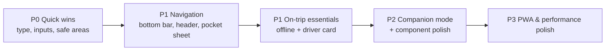

# Thailand 2027 — Mobile UI/UX Improvement Plan

**Route:** `/naanas-space/thailand-2027` · **Audience:** Shaq & Naana · **Main use case:** phones, both before the trip (planning) and in Thailand (4–14 Feb 2027)

> [!NOTE]
> This plan comes from reading the current code (`page.tsx`, `StickyStepNav`, `TopEditorialBar`, `EditorialMasthead`, `QuickPocketDesk`, the drawers and modals, and the six Step components). Every change has to keep the copywriting rules in `thailand_2027_context_handoff.md`: always "Shaq", never "Shaquille", and no second-person copy aimed at Shaq alone.

---

## 1. What we found (mobile audit)

| # | Area | Current behaviour | Mobile impact |
|---|------|-------------------|---------------|
| A1 | **Sticky step nav** (`StickyStepNav.tsx`) | `grid-cols-2` on mobile, so 6 tabs = **3 stacked rows**, plus the date ruler on Step I | Even when compact, the sticky header takes about 25–35% of a 390×844 screen, leaving little room for content |
| A2 | **Floating elements collide** | Quick Pocket Desk `fixed bottom-5 left-5`, scroll-to-top `fixed bottom-5 right-5`, and "Copied" toast `fixed bottom-6 right-6` | The toast sits on top of the scroll button. The open Pocket Desk (`w-80`, 320px plus a 20px inset) runs off the edge of 320–360px phones. Nothing accounts for the iPhone home indicator |
| A3 | **Tap targets** | Activity checkboxes are `w-5 h-5` (20px). Top-bar buttons use `py-0.5`. Compact day-ruler chips use `py-0.5` | Well under the 44×44px minimum, so mis-taps are likely, especially while walking around |
| A4 | **Tiny type** | ~143 × `text-[10px]`, 26 × `text-[9px]`, 3 × `text-[8px]`, often uppercase with wide tracking | Hard to read on a phone in bright sunlight |
| A5 | **iOS input zoom** | All 36 inputs use `text-xs`/`text-sm` (<16px). Currency uses `type="number"`. Times are free-text | iOS Safari zooms in on focus and the layout jumps. The keyboard isn't the best one for numbers or times |
| A6 | **Hover-only affordances** | Polaroid "Expand ⤢" pill is `opacity-0 group-hover:opacity-100`. 17 `title=""` tooltips carry helpful explanations | Touch devices never show any of these |
| A7 | **Drawers & modals** | Change Log and Wardrobe drawers are right-side slide-overs with `p-6`. `CreateLookModal` uses `max-h-[90vh]`. There's no body scroll lock and no swipe to dismiss | `vh` is wrong when the iOS URL bar shows or hides. Thumbs can't reach the close buttons (top-right). The page behind can scroll |
| A8 | **Top editorial bar** | Back link, editor toggle, change log, sync status and dates all `flex-wrap` | Wraps onto 2–3 rows on phones and looks cluttered before any content shows |
| A9 | **Masthead** | `text-5xl` title plus a `text-4xl` countdown and the readiness dossier | The first screen on a phone is all branding, with no actionable content |
| A10 | **Budget ledger** | `<table>` inside `overflow-x-auto` | Needs sideways scrolling on phones, and the columns are cramped |
| A11 | **Itinerary rows** | Each activity can show checkbox, EDIT, REMOVE, outfit/hanger, INFO and links inline | Action-heavy rows wrap untidily and are easy to mis-tap |
| A12 | **Offline / connectivity** | State goes to localStorage and then a cloud sync. Fonts load through `@import` from Google Fonts + cdnfonts | In Thailand (roaming, eSIM, patchy signal) the page shell, fonts and API may fail. The `@import` blocks rendering |
| A13 | **No "on-the-trip" mode** | The page always opens on Step I, "Full Spread" | During the trip, the questions are "what's next today?" and "show the driver where we're going", and nothing answers those directly |

---

## 2. Guiding principles

1. **Thumb-first.** Put primary actions in the bottom ~40% of the screen, and make tap targets ≥44px.
2. **One sticky element at a time.** Keep chrome to roughly 15% of the screen height or less.
3. **Two modes:** *Planning* (before 4 Feb) and *Companion* (4–14 Feb), with defaults that suit each.
4. **Works offline.** Anything needed on the ground must work with no signal.
5. **Keep the editorial look.** Keep the serif, mono and palette, but turn the type scale up for mobile.

---

## 3. Proposed improvements

### Phase 1 — Quick wins (low effort, high impact)

#### 1.1 Mobile type & tap-target floor
- Add mobile type tokens to `styles.tsx` (for example `eyebrow`, `meta`, `body`) and replace the hard-coded `text-[8–10px]` with a **minimum of 11px on mobile** (`text-[11px] sm:text-[10px]` where the desktop design relies on the smaller size).
- Cut letter-spacing on mobile from `tracking-[0.2em]` to `tracking-[0.1em]`.
- Make sure every interactive element is **at least 44×44px** on mobile (`min-h-11 min-w-11`). Keep checkboxes visually at 20px but give them a padded 44px hit area.

#### 1.2 Fix iOS input zoom & keyboards
- Use `text-base sm:text-sm` (16px on mobile) for every `<input>`, `<textarea>` and `<select>`.
- Currency and expense amounts: `type="text" inputMode="decimal" pattern="[0-9]*"`.
- Activity time: `type="time"` (native wheel picker) instead of free text.
- Add `enterKeyHint="done"` / `"next"` and `autoComplete="off"` where it fits.

#### 1.3 Viewport, safe areas & dynamic height
- Export `viewport` from the route layout: `viewportFit: "cover"`, `themeColor: "#F6F1E7"`.
- Add `pb-[env(safe-area-inset-bottom)]` to every bottom-fixed element.
- Replace `90vh`/`68vh`/`64vh` with `dvh` equivalents.

#### 1.4 Remove hover-only affordances
- Show the Polaroid "Expand" pill all the time on touch: `opacity-100 sm:opacity-0 sm:group-hover:opacity-100`, or use `@media (hover: hover)`.
- Turn important `title` tooltips into visible helper text, or into an ⓘ button that opens a small popover.

#### 1.5 Toast & floating-button collision
- Move the "Copied" toast to **top-centre** (below the sticky nav), or make it a full-width snackbar above the bottom bar.
- Fold the scroll-to-top button into the new bottom bar (see 2.1) so the floating buttons stop competing.

#### 1.6 Font loading
- Swap the `@import` in `layout.tsx` for `next/font/google` (DM Serif Display, Plus Jakarta Sans, JetBrains Mono, Orbitron) and self-host DS-Digital with `next/font/local`. This removes render-blocking requests and the extra third-party CDN, and it helps offline use (A12).

---

### Phase 2 — Navigation & layout restructure

#### 2.1 Bottom tab bar (mobile only)
Replace the 3-row grid nav on `< sm` with a fixed **bottom navigation bar**:

```
┌──────────────────────────────────────────┐
│  📅 Plan   🎫 Vault   ✓ Prep   🧳 Pack   ⋯ More │
└──────────────────────────────────────────┘
```
- 4 primary tabs plus **More**, which opens a sheet with *Field Guide & SOS*, *Budget & THB*, *Change Log* and the editor toggle.
- Show progress badges on the tabs (e.g. `Prep 12/15`, `Pack 18/21`).
- Keep the current grid nav for `sm+` (tablet and desktop) so nothing changes on desktop.
- The top sticky area on mobile becomes **only the date ruler** (Step I) or a thin step title, about 44px tall.

#### 2.2 Compact mobile header (replaces wrapped `TopEditorialBar`)
- One row: `← Naana's Space` · centred title "Thailand '27" · **avatar chip** (S / N, coloured green / terracotta) for the editor toggle · sync dot (●/◌/○).
- Move dates, the full sync label and the Change Log button into the **More** sheet.

#### 2.3 Collapsible masthead
- On mobile, show a **compact hero card**: countdown on one line (`83d 14h 22m`) plus a readiness ring and three jump chips.
- Allow "Show full dossier ▾" to expand the full editorial masthead.
- Hide the masthead entirely in Companion mode (3.1).

#### 2.4 Date ruler improvements (Step I)
- Snap scrolling (`snap-x snap-mandatory`) and auto-scroll the selected or current day into the centre.
- Fade edges to show there's more to scroll.
- When a single day is selected, **swipe left/right** on the content to move between days.

#### 2.5 Quick Pocket Desk → bottom sheet
- On mobile, trigger it from a **centre "฿" action** in the bottom bar (or from More) instead of a floating box in the bottom-left.
- Show it as a **bottom sheet** (`<dialog>` with full width, rounded top, drag handle, `max-h-[85dvh]`) that has: converter with quick presets (100/500/1000 ฿), PNR copy chips at 44px height, driver-card buttons and SOS speed-dials.

---

### Phase 3 — Companion ("on-the-trip") mode

#### 3.1 Today view
When the device date is between 4 and 14 Feb 2027 (with a manual toggle for testing):
- Open on **Step I, filtered to today's day**, with the masthead hidden.
- **"Up next" card** pinned at the top: next activity, time until it starts, venue, and buttons for **Maps**, **Driver card** and **Grab**.
- **"Now" marker** on the timeline; past activities dimmed, and a suggestion to tick off completed ones.
- **Tonight's outfit** chip, linked to the wardrobe.

#### 3.2 Driver card upgrades (`DriverCardModal.tsx`)
- True full screen (`inset-0`, no margins), Thai name at **`text-4xl`+**, address `text-2xl`.
- **Rotate-to-landscape** layout so the phone is easy to hand to a driver.
- **Screen Wake Lock API** to keep the display on while the card is open.
- Large "Call hotel" `tel:` button; a **"Share"** button (`navigator.share`) to send the address on LINE or WhatsApp.
- Move close to a bottom "Done" button that's easy to reach with a thumb.

#### 3.3 SOS always reachable
- In Companion mode, add an **SOS** entry to the bottom bar or More sheet (1155 Tourist Police, 1669 ambulance, hotel numbers, embassy) as large tap-to-call rows.

---

### Phase 4 — Component-level mobile polish

#### 4.1 Drawers → bottom sheets
For `ChangeLogDrawer`, `WardrobeDrawer` and `CreateLookModal` on mobile:
- Use a bottom sheet with a drag handle and **swipe down to close**, `h-[92dvh]`, a sticky header and a **sticky footer action bar** (Save / Assign / Cancel).
- Reduce padding to `p-4` on mobile.
- **Lock body scroll** while open; **trap focus** and close on Escape (or use the native `<dialog>` everywhere, which `CreateLookModal` already does).
- Change Log filter pills: one horizontally scrollable row instead of wrapping.

#### 4.2 Itinerary activity rows
- Main row: checkbox (44px hit area) · time · title · category tag.
- Move secondary actions (Edit, Remove, Outfit, Info) into a **"⋯" action sheet**, or **swipe left** to reveal Edit/Remove.
- Suggestions: collapse to the top three with "Show all (n)", and turn `✓ INSCRIBED (TAP TO UNDO)` into a compact toggle chip plus an **Undo snackbar**.
- Inline edit form: use a bottom sheet on mobile instead of inline expansion, so the keyboard doesn't push the form out of view.

#### 4.3 Budget ledger → card list
- Below `sm`, show each expense as a card (title, THB, GBP, booked toggle, delete in the overflow menu) instead of the `<table>`.
- Pin a **sticky summary bar** (Total planned · Booked · Surplus £72.65) at the bottom of Step VI.

#### 4.4 Packing Studio
- Use a 2-column Polaroid grid on mobile with larger tiles; tap opens full screen with **swipe between garments**.
- Packing checklist: large rows, **tap anywhere on the row** to toggle, grouped and collapsible by category, with a "Hide packed" filter.
- `CreateLookModal` image upload: add `accept="image/*"` and `capture="environment"` so the phone camera is offered; drag-and-drop stays for desktop.

#### 4.5 Bookings Vault
- PNR cipher strip: horizontally scrollable chips, 44px tall, with a ✓ shown inline after copying.
- Flight cards: put the key facts (time, gate/terminal, seat, PNR) first, with baggage and payment details collapsed under "Details".

#### 4.6 Feedback & micro-interactions
- `navigator.vibrate(10)` on check-off (Android; skip quietly on iOS).
- Undo snackbar for every destructive action (remove activity, delete expense, clear log). The Change Log already records these.

---

### Phase 5 — Offline, PWA & performance

#### 5.1 Installable PWA
- Add `manifest.webmanifest` (name "Thailand 2027", icons, `display: standalone`, theme colours) scoped to `/naanas-space/thailand-2027`.
- iOS: `apple-mobile-web-app-capable`, status-bar style, splash colour.
- Add a short "Add to Home Screen" tip in the More sheet.

#### 5.2 Offline support
- Service worker (e.g. Serwist / `next-pwa`) that pre-caches the route shell, JS/CSS chunks, fonts and garment images.
- **Offline write queue:** while offline, keep writing to localStorage and mark sync as "Pending (n)". When `online` fires, flush the queue to the API.
- Visible offline banner: "Offline — changes saved on this phone, will sync later".

#### 5.3 Performance
- Replace the scroll listener in `StickyStepNav` with the `IntersectionObserver` sentinel only.
- Use `backdrop-blur` sparingly on mobile (it's expensive on low-end GPUs); use a solid `bg-[#F6F1E7]` below `sm`.
- `content-visibility: auto` on collapsed and off-screen day cards.
- `next/image` with `sizes` for wardrobe images; lazy-load images below the fold.
- Code-split heavy, rarely used components (`CreateLookModal`, `WardrobeDrawer`) with `next/dynamic`.

---

## 4. Prioritised roadmap

| Priority | Item | Effort | Impact |
|---------|------|--------|--------|
| P0 | 1.1 Type & tap-target floor | S | High |
| P0 | 1.2 iOS zoom & keyboards | S | High |
| P0 | 1.3 Safe areas & `dvh` | S | Med |
| P0 | 1.5 Toast / FAB collision | S | Med |
| P1 | 2.1 Bottom tab bar | M | **Very high** |
| P1 | 2.2 Compact header | S | High |
| P1 | 2.5 Pocket Desk bottom sheet | M | High |
| P1 | 3.2 Driver card upgrades | S | High (on-trip) |
| P1 | 5.2 Offline support | M | **Very high (on-trip)** |
| P2 | 3.1 Today / Companion mode | M | Very high (on-trip) |
| P2 | 2.3 Collapsible masthead | S | Med |
| P2 | 4.1 Drawers → bottom sheets | M | Med |
| P2 | 4.2 Itinerary row actions | M | High |
| P2 | 4.3 Budget card list | S | Med |
| P3 | 1.4, 1.6, 2.4, 4.4–4.6, 5.1, 5.3 | S–M | Polish |



> [!IMPORTANT]
> Aim to finish **P0, P1 and offline support well before the 2 Feb 2027 TDAC window**, so both phones can be tested with the PWA installed and airplane mode on before departure.

---

## 5. Testing & verification

- **Devices / viewports:** 360×780 (small Android), 390×844 (iPhone 15), 430×932 (Pro Max), plus landscape and an iPad.
- **Jest/RTL:** update `StickyStepNav.test.tsx` and `thailand-2027.test.tsx` for the bottom bar, the More sheet and Companion mode (mock `Date`). Add tests for the offline queue and for the 16px input font-size class.
- **Lighthouse mobile:** target Performance ≥ 90, Accessibility ≥ 95, PWA installable.
- **Manual on-trip rehearsal:** airplane mode → open the installed PWA → tick off an activity, add an expense, open a driver card → reconnect → confirm the cloud sync and Change Log attribution (Shaq / Naana).
- **Copy review:** check all new strings against the handoff rules ("Shaq", no Shaq-only "you").

---

## 6. Open questions for Shaq & Naana

1. Which **4 tabs** belong in the bottom bar? Proposed: Plan, Vault, Prep, Pack, with Guide and Budget under More.
2. Should Companion mode **switch on automatically** on 4 Feb, or only through a toggle?
3. Is installing as a **home-screen app** (PWA) fine for both phones?
4. Any must-have on-the-ground features missing (e.g. a shared photo log, a tipping calculator, LINE contact cards)?
